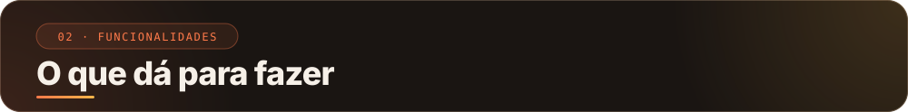
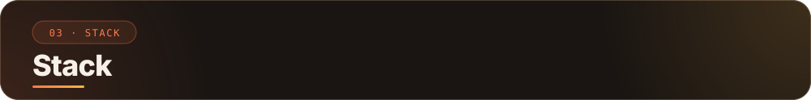
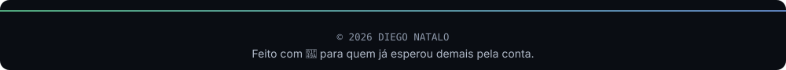

<!-- Arquivo gerado pelo readme-kit. Não edite aqui: altere docs/readme/ e rode "readme-kit build". -->
<div align="center">


<br />

<a href="https://pede-ai.vercel.app"></a>
<a href="https://github.com/diegonatalo/pede-ai"></a>

<br />


</div>

<br />

<div align="center">


</div>

**Descreva o projeto em uma frase.**<br />
Descreva o que o projeto faz, para quem e por que existe.

<br />

<div align="center">



</div>

<div align="center">


</div>

<br />

<div align="center">



</div>

<div align="center">


</div>

<br />

<div align="center">


</div>

Requer [Node.js](https://nodejs.org) e [pnpm](https://pnpm.io).

```bash
git clone https://github.com/diegonatalo/pede-ai.git
cd pede-ai
pnpm install
pnpm dev        # http://localhost:3000
```

| Comando | O que faz |
|---|---|
| `pnpm dev` | Servidor de desenvolvimento |
| `pnpm build` | Gera o build de produção |
| `pnpm start` | Serve o build de produção |
| `pnpm lint` | Roda o ESLint |
| `pnpm test` | Roda os testes |
| `pnpm test:coverage` | Descreva o que faz |
| `pnpm test:watch` | Descreva o que faz |

### 🔑 Variáveis de ambiente

Nenhuma é necessária.

### 🧪 Testes

```bash
pnpm test
```

Descreva o que os testes cobrem.

Para reexecutar ao salvar: `pnpm test:watch`.

<br />

<div align="center">


</div>

```text
app/              Descreva
components/       Descreva
docs/             Descreva
hooks/            Descreva
lib/              Descreva
public/           Descreva
```

<br />

<div align="center">


</div>

### 🧠 Como funciona

| Conceito | Regra |
|---|---|
| **Exemplo** | Descreva. |

### 🌐 Deploy

Descreva onde o projeto é publicado e o que muda ao trocar de domínio.

### 🧭 Próximos passos

- [ ] Testes automatizados.

### 📄 Créditos e licença

- Distribuído sob a licença **MIT**. Veja o arquivo [LICENSE](LICENSE).

<br />

<div align="center">


</div>

<div align="center">

<a href="https://diegonatalo.dev"></a>
<a href="https://www.linkedin.com/in/diegonatalo/"></a>
<a href="https://github.com/diegonatalo"></a>

</div>

<br />

<div align="center">



</div>
