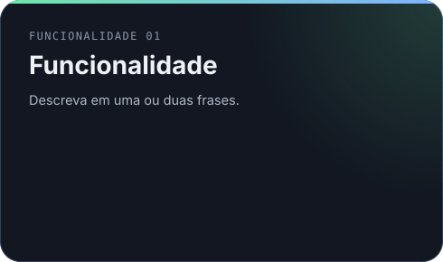
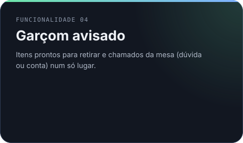
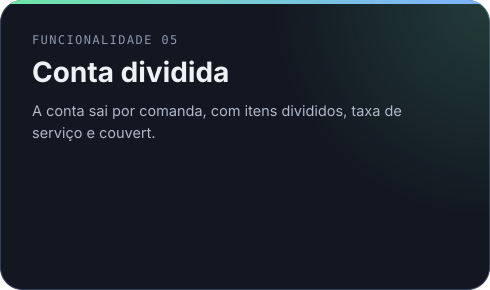
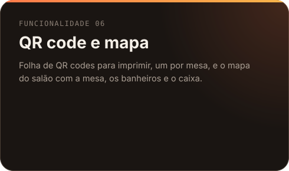
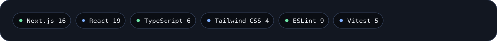
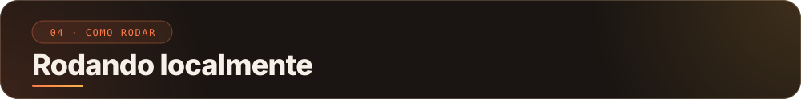
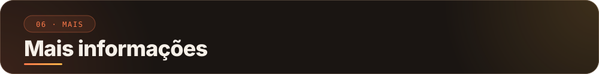
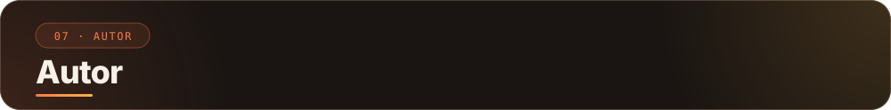

<!-- Arquivo gerado pelo readme-kit. Não edite aqui: altere docs/readme/ e rode "readme-kit build". -->
<div align="center">


<br />

<a href="https://dn-pede-ai.vercel.app"></a>
<a href="https://github.com/diegonatalo/pede-ai"></a>

<br />


</div>

<br />

<div align="center">


</div>

**Pedidos pela mesa, comanda para cada pessoa e conta dividida.**<br />
O Pede Aí é um sistema de pedidos para restaurantes. Cada mesa tem um QR code: o cliente escaneia, abre a própria comanda e pede pelo celular. Os itens vão para a fila da cozinha ou do bar, o garçom é avisado quando ficam prontos e leva até a mesa. Pelo app, o cliente também chama o garçom para tirar dúvidas ou pedir a conta.

O caso central é a mesa compartilhada: dois casais ou um grupo de amigos, cada pessoa com a sua comanda, e a conta dividida por comanda (inclusive o item que foi dividido entre várias).

O projeto está em construção, como demo e portfólio.

<br />

<div align="center">


</div>

<div align="center">



<br />


<br />



</div>

<br />

<div align="center">


</div>

<div align="center">



</div>

<br />

<div align="center">



</div>

Requer [Node.js](https://nodejs.org) e [pnpm](https://pnpm.io).

```bash
git clone https://github.com/diegonatalo/pede-ai.git
cd pede-ai
pnpm install
pnpm dev        # http://localhost:3000
```

| Comando | O que faz |
|---|---|
| `pnpm dev` | Servidor de desenvolvimento |
| `pnpm build` | Checa os tipos e gera o build de produção |
| `pnpm start` | Serve o build de produção |
| `pnpm lint` | Roda o ESLint |
| `pnpm test` | Roda os testes (Vitest) |
| `pnpm test:coverage` | Roda os testes com relatório de cobertura |
| `pnpm test:watch` | Reexecuta os testes ao salvar |
| `pnpm test:e2e` | Roda os testes de ponta a ponta (Playwright) |
| `pnpm db:generate` | Gera uma migração nova a partir de `lib/db/schema.ts` |
| `pnpm db:migrate` | Aplica as migrações no banco do `.env.local` (conexão direta) |

### 🔑 Variáveis de ambiente

Todas são opcionais no computador: sem banco, os dados ficam na memória do servidor.

| Variável | Descrição | Se não definir |
|---|---|---|
| `DATABASE_URL` | Postgres (Neon) com pooling, usado pelo app. Criada pela integração Neon da Vercel. | Dados na memória |
| `DATABASE_URL_UNPOOLED` | Conexão direta, usada pelas migrações (`pnpm db:migrate`). | Usa a `DATABASE_URL` |
| `PEDE_AI_STORE` | `postgres` para usar o banco no computador. Fora da Vercel, o padrão é a memória, para o `pnpm dev` e o E2E não gravarem no banco de produção. | Memória |
| `TEST_DATABASE_URL` | Banco de teste (um branch do Neon) para rodar os testes do store no Postgres. Cada teste apaga as tabelas: nunca use o de produção. | Testes do Postgres pulados |
| `SESSION_SECRET` | Chave que assina os cookies do cliente e da equipe e, sem `BETTER_AUTH_SECRET`, também as sessões das contas. **Obrigatória na Vercel**: lá há várias instâncias, e cada uma geraria a própria chave. | Gera uma chave aleatória a cada início do servidor |
| `BETTER_AUTH_SECRET` | Chave só do login das contas (Better Auth), se quiser separada da `SESSION_SECRET`. | Usa a `SESSION_SECRET` |
| `BETTER_AUTH_URL` | Endereço do site para o login, se for diferente do `NEXT_PUBLIC_SITE_URL`. | Na Vercel, o endereço do site; no computador, `localhost` em qualquer porta |
| `NEXT_PUBLIC_SITE_URL` | URL pública do site, usada nas tags Open Graph, no `robots.txt` e no `sitemap.xml`. Sem barra no final. | Usa `https://dn-pede-ai.vercel.app` |

### 🧪 Testes

```bash
pnpm test
```

Usa [Vitest](https://vitest.dev) e Testing Library. Cobrem a formatação e a leitura de valores em reais (sempre em centavos inteiros), a consistência dos dados de demonstração (ids, categorias, preços, mapa sem sobreposição) as regras de estado (quem pode levar um item, uma comanda ou um chamado para o próximo estado, o que pode ser desfeito e quando a mesa pode fechar) a conta de cada comanda (itens divididos sem perder nem criar centavos, cancelados fora, taxa de serviço e couvert por pessoa, uma mesa com dois casais e uma amiga) os serviços da API (o cliente só mexe na própria comanda, PIN e papel da equipe, cookies assinados), o carrinho, o polling (pausa com a aba escondida), as filas do garçom (confirmar, retirar, chamados, situação das mesas) e da cozinha (colunas por estado, filtro por estação), a divisão de itens em partes, o link e o QR de cada mesa, a descrição do mapa em palavras, os números do dia (faturamento, ticket por pessoa, tempos médios de preparo e de entrega, mais pedidos), o login das contas (criar, entrar, senha errada, e-mail repetido), a equipe com PIN pessoal (cadastro, PIN repetido, novo PIN, desativar, bloqueio após muitos erros, quem fez cada ação), as telas do cliente (código da mesa, comanda, cardápio, carrinho, pedidos, conta com divisão, chamar o garçom) , do garçom (login por PIN, agora, mesas) , da cozinha (fila, esgotar item) e do gerente (números, QR codes, ajustes de taxa, couvert e confirmação), o mapa do salão, o isolamento entre restaurantes (dois restaurantes no mesmo banco, e nenhum vê ou muda nada do outro: mesas, comandas, itens, chamados, eventos, cardápio, equipe e PINs), o endereço de cada restaurante (a API recusa restaurante que não existe, e o login da equipe num restaurante não abre as telas de outro), a camada de dados (o mesmo contrato roda na memória e, com `TEST_DATABASE_URL`, no Postgres; tentativas de novo quando duas gravações se cruzam) (abrir e fechar a mesa, código com bloqueio depois de 5 erros, confirmação do primeiro pedido, item esgotado, divisão, chamados e o registro de eventos) e a tela de erro. As telas entram com testes a cada etapa.

Para reexecutar ao salvar: `pnpm test:watch`.

Os testes de ponta a ponta (Playwright, em `e2e/`) abrem o app no Chromium contra o build de produção e conferem que as páginas abrem sem erros, que a 404 leva de volta ao início, que as telas abrem pelo endereço do restaurante (`/r/demo/...`) e avisam quando ele não existe, dois casais e uma amiga na mesma mesa, cada um com a sua comanda, dividindo um vinho em partes diferentes e conferindo o total de cada conta centavo a centavo até o garçom receber e fechar a mesa, o chamado do garçom do celular até a tela dele, o gerente cadastrando um garçom que entra com o próprio PIN e perde o acesso ao ser desativado, o dono criando a conta, saindo e entrando de novo, a cozinha e o bar preparando pela fila e esgotando um item enquanto o cliente acompanha, o garçom abrindo a mesa, confirmando, entregando, recebendo e fechando enquanto o cliente acompanha pelo celular, o pedido pela tela com dois celulares na mesma mesa (cada um vê só os próprios pedidos, o estado atualiza sozinho e nada se perde ao recarregar) e o fluxo completo pela API, com aparelhos separados: o garçom abre a mesa, o cliente entra com o código e pede, a cozinha prepara, o garçom entrega e fecha a mesa.

```bash
pnpm exec playwright install chromium   # só na primeira vez
pnpm test:e2e                           # gera o build e testa contra ele
```

<br />

<div align="center">


</div>

```text
app/              Rotas (página inicial, 404, erros, robots, sitemap, imagem OG)
app/api/          Route Handlers finos sobre os serviços de lib/api
components/       Corpo das telas (account/ para a conta do dono, customer/ para o celular do cliente, waiter/, kitchen/, manager/ e staff/ para a equipe, ui/ para estilos comuns)
docs/             Textos e imagens do README (readme-kit)
e2e/              Testes de ponta a ponta (Playwright)
hooks/            Estado e efeitos de React (polling do feed, visão do cliente e da equipe, tela acesa, aviso sonoro)
lib/              Lógica pura (dinheiro, estados, conta), login das contas (lib/auth, Better Auth), serviços da API (lib/api), camada de dados (lib/store: regras + memória ou Postgres), banco (lib/db: schema e migrações) e dados de demonstração
types/            Tipos do domínio (mesa, comanda, pedido, item, chamado)
```

<br />

<div align="center">



</div>

### 🧠 Como funciona

| Conceito | Regra |
|---|---|
| **Sessão da mesa** | O garçom abre a mesa quando o grupo senta. Só dá para pedir com a mesa aberta e o código de 4 dígitos. |
| **Comanda** | Cada pessoa (ou aparelho) tem a sua. O primeiro pedido de cada comanda passa pela confirmação do garçom. |
| **Item** | Enviado → em preparo → pronto → retirado → entregue. Cada item vai para a cozinha ou para o bar. |
| **Conta do dono** | O dono do restaurante cria a conta com e-mail e senha (Better Auth; senha guardada só como hash, sessões no banco). Sem serviço externo: por enquanto não há confirmação de e-mail nem redefinição por link. |
| **Equipe** | Cada pessoa tem o próprio PIN de 6 dígitos, criado pelo gerente na seção Equipe e mostrado uma vez só. O banco guarda só uma chave derivada do PIN (HMAC com a chave do app). Cada ação registra quem fez; quem é desativado perde o acesso na hora. O gerente pode usar qualquer tela; as outras pessoas, só a do próprio papel. A demonstração tem uma pessoa por papel com os PINs públicos 1111, 2222 e 3333. |
| **Acesso** | O celular do cliente e o da equipe guardam um cookie assinado. A equipe entra com o PIN pessoal, e o cookie guarda quem entrou em cada tela. |
| **Vários restaurantes** | Cada restaurante tem endereço próprio (slug) e o próprio salão, cardápio, equipe, mesas e eventos. A camada de dados é criada para um restaurante e toda consulta filtra por ele: nada de um aparece ou muda no outro, nem pelo id. As telas ficam no endereço do restaurante (`/r/<slug>/mesa/<id>`, `/r/<slug>/garcom`, `/r/<slug>/cozinha`, `/r/<slug>/gerente`), o QR de cada mesa aponta para lá e o login da equipe vale só no restaurante em que foi feito. Os endereços antigos (`/garcom`, `/mesa/<id>`…) abrem a demonstração. |
| **Duas pessoas ao mesmo tempo** | Cada mesa tem uma versão. Uma gravação só vale se ninguém gravou a mesma mesa desde a leitura; se gravou, o app relê e tenta de novo. |
| **Conta** | Calculada por comanda, em centavos inteiros: itens próprios, partes de itens divididos, taxa de serviço e couvert. |

### 🌐 Deploy

Publicado na [Vercel](https://vercel.com), que faz deploy só da branch `main` (`vercel.json`). Para trocar de domínio, defina `NEXT_PUBLIC_SITE_URL` no build.

Na Vercel, os dados ficam no Postgres do Neon (integração da Vercel, que cria a `DATABASE_URL`). No computador, sem `PEDE_AI_STORE=postgres`, ficam na memória do servidor e somem quando ele reinicia.

Mudou o schema (`lib/db/schema.ts`)? Rode `pnpm db:generate`, revise a migração em `lib/db/migrations/` e rode `pnpm db:migrate` **antes** de mesclar o PR, para o deploy já encontrar o banco atualizado. Os dados de demonstração (cardápio, mesas, mapa) são gravados sozinhos no primeiro acesso.

### 🧭 Próximos passos

- [ ] Domínio: tipos, estados do pedido e cálculo da conta por comanda.
- [x] Tela do cliente: entrar com o código, abrir a comanda, cardápio, carrinho e pedidos.
- [x] Tela do garçom: login por PIN, abrir mesa, confirmar o primeiro pedido, retirar e entregar, receber e fechar.
- [x] Tela da cozinha e do bar: fila em três colunas, filtro por estação e item esgotado.
- [x] Chamar o garçom e conta pelo celular, com divisão de itens em partes.
- [x] Banco de dados (Postgres no Neon, com Drizzle) para funcionar em vários aparelhos.
- [x] Tela do gerente: salão, números do dia e ajustes (taxa, couvert, confirmação do primeiro pedido).
- [x] QR codes para imprimir (um por mesa) e mapa do salão no celular do cliente.
- [x] Fase 2, etapa 1a: conta do dono com e-mail e senha.
- [x] Fase 2, etapa 1b: equipe com PIN pessoal e registro de quem fez cada ação.
- [ ] Fase 2: chamados em tempo real, login de verdade para a equipe, pagamento e nota fiscal.

### 📄 Créditos e licença

- Distribuído sob a licença **MIT**. Veja o arquivo [LICENSE](LICENSE).

<br />

<div align="center">



</div>

<div align="center">

<a href="https://diegonatalo.dev"></a>
<a href="https://www.linkedin.com/in/diegonatalo/"></a>
<a href="https://github.com/diegonatalo"></a>

</div>

<br />

<div align="center">


</div>
