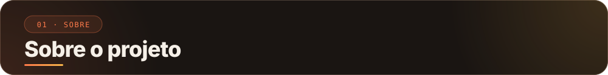
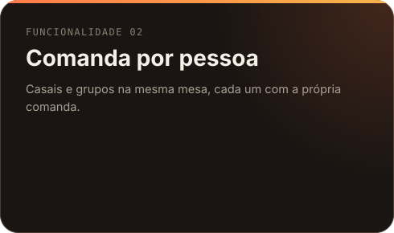
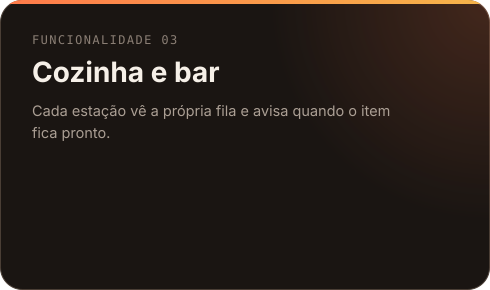
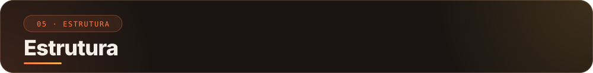

<!-- Arquivo gerado pelo readme-kit. Não edite aqui: altere docs/readme/ e rode "readme-kit build". -->
<div align="center">



<br />

<a href="https://pede-ai.vercel.app"></a>
<a href="https://github.com/diegonatalo/pede-ai"></a>

<br />


</div>

<br />

<div align="center">



</div>

**Pedidos pela mesa, comanda para cada pessoa e conta dividida.**<br />
O Pede Aí é um sistema de pedidos para restaurantes. Cada mesa tem um QR code: o cliente escaneia, abre a própria comanda e pede pelo celular. Os itens vão para a fila da cozinha ou do bar, o garçom é avisado quando ficam prontos e leva até a mesa. Pelo app, o cliente também chama o garçom para tirar dúvidas ou pedir a conta.

O caso central é a mesa compartilhada: dois casais ou um grupo de amigos, cada pessoa com a sua comanda, e a conta dividida por comanda (inclusive o item que foi dividido entre várias).

O projeto está em construção, como demo e portfólio.

<br />

<div align="center">


</div>

<div align="center">



<br />


<br />


</div>

<br />

<div align="center">


</div>

<div align="center">


</div>

<br />

<div align="center">


</div>

Requer [Node.js](https://nodejs.org) e [pnpm](https://pnpm.io).

```bash
git clone https://github.com/diegonatalo/pede-ai.git
cd pede-ai
pnpm install
pnpm dev        # http://localhost:3000
```

| Comando | O que faz |
|---|---|
| `pnpm dev` | Servidor de desenvolvimento |
| `pnpm build` | Checa os tipos e gera o build de produção |
| `pnpm start` | Serve o build de produção |
| `pnpm lint` | Roda o ESLint |
| `pnpm test` | Roda os testes (Vitest) |
| `pnpm test:coverage` | Roda os testes com relatório de cobertura |
| `pnpm test:watch` | Reexecuta os testes ao salvar |
| `pnpm test:e2e` | Roda os testes de ponta a ponta (Playwright) |

### 🔑 Variáveis de ambiente

Todas são opcionais na demonstração.

| Variável | Descrição | Se não definir |
|---|---|---|
| `SESSION_SECRET` | Chave que assina os cookies do cliente e da equipe. Obrigatória com mais de um servidor. | Gera uma chave aleatória a cada início do servidor |
| `STAFF_PIN_KITCHEN`, `STAFF_PIN_WAITER`, `STAFF_PIN_MANAGER` | PIN de cada papel da equipe. | PINs da demo: `1111`, `2222` e `3333` |
| `NEXT_PUBLIC_SITE_URL` | URL pública do site, usada nas tags Open Graph, no `robots.txt` e no `sitemap.xml`. Sem barra no final. | Usa `https://pede-ai.vercel.app` |

### 🧪 Testes

```bash
pnpm test
```

Usa [Vitest](https://vitest.dev) e Testing Library. Cobrem a formatação e a leitura de valores em reais (sempre em centavos inteiros), a consistência dos dados de demonstração (ids, categorias, preços, mapa sem sobreposição) as regras de estado (quem pode levar um item, uma comanda ou um chamado para o próximo estado, o que pode ser desfeito e quando a mesa pode fechar) a conta de cada comanda (itens divididos sem perder nem criar centavos, cancelados fora, taxa de serviço e couvert por pessoa, uma mesa com dois casais e uma amiga) os serviços da API (o cliente só mexe na própria comanda, PIN e papel da equipe, cookies assinados), a camada de dados em memória (abrir e fechar a mesa, código com bloqueio depois de 5 erros, confirmação do primeiro pedido, item esgotado, divisão, chamados e o registro de eventos) e a tela de erro. As telas entram com testes a cada etapa.

Para reexecutar ao salvar: `pnpm test:watch`.

Os testes de ponta a ponta (Playwright, em `e2e/`) abrem o app no Chromium contra o build de produção e conferem que as páginas abrem sem erros, que a 404 leva de volta ao início e o fluxo completo pela API, com aparelhos separados: o garçom abre a mesa, o cliente entra com o código e pede, a cozinha prepara, o garçom entrega e fecha a mesa.

```bash
pnpm exec playwright install chromium   # só na primeira vez
pnpm test:e2e                           # gera o build e testa contra ele
```

<br />

<div align="center">



</div>

```text
app/              Rotas (página inicial, 404, erros, robots, sitemap, imagem OG)
app/api/          Route Handlers finos sobre os serviços de lib/api
components/       Corpo das telas
docs/             Textos e imagens do README (readme-kit)
e2e/              Testes de ponta a ponta (Playwright)
hooks/            Estado e efeitos de React
lib/              Lógica pura (dinheiro, estados, conta), serviços da API (lib/api), camada de dados (lib/store) e dados de demonstração
types/            Tipos do domínio (mesa, comanda, pedido, item, chamado)
```

<br />

<div align="center">


</div>

### 🧠 Como funciona

| Conceito | Regra |
|---|---|
| **Sessão da mesa** | O garçom abre a mesa quando o grupo senta. Só dá para pedir com a mesa aberta e o código de 4 dígitos. |
| **Comanda** | Cada pessoa (ou aparelho) tem a sua. O primeiro pedido de cada comanda passa pela confirmação do garçom. |
| **Item** | Enviado → em preparo → pronto → retirado → entregue. Cada item vai para a cozinha ou para o bar. |
| **Acesso** | O celular do cliente e o da equipe guardam um cookie assinado. A equipe entra com o PIN do papel (cozinha, garçom ou gerente). |
| **Conta** | Calculada por comanda, em centavos inteiros: itens próprios, partes de itens divididos, taxa de serviço e couvert. |

### 🌐 Deploy

Publicado na [Vercel](https://vercel.com), que faz deploy só da branch `main` (`vercel.json`). Para trocar de domínio, defina `NEXT_PUBLIC_SITE_URL` no build.

### 🧭 Próximos passos

- [ ] Domínio: tipos, estados do pedido e cálculo da conta por comanda.
- [ ] Telas do cliente, da cozinha, do bar e do garçom.
- [ ] Banco de dados (Postgres) para funcionar em vários aparelhos.
- [ ] Visão do gerente, QR codes para imprimir e mapa do salão.

### 📄 Créditos e licença

- Distribuído sob a licença **MIT**. Veja o arquivo [LICENSE](LICENSE).

<br />

<div align="center">


</div>

<div align="center">

<a href="https://diegonatalo.dev"></a>
<a href="https://www.linkedin.com/in/diegonatalo/"></a>
<a href="https://github.com/diegonatalo"></a>

</div>

<br />

<div align="center">


</div>
